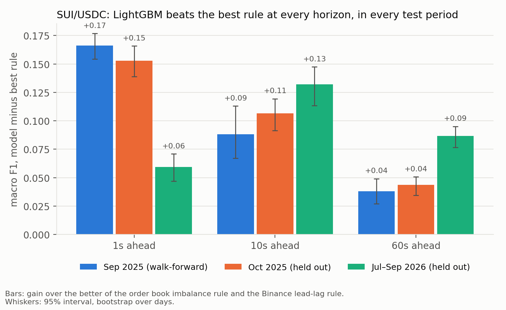
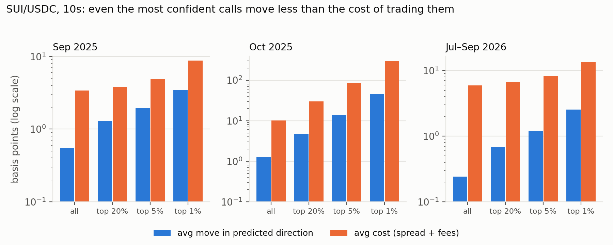
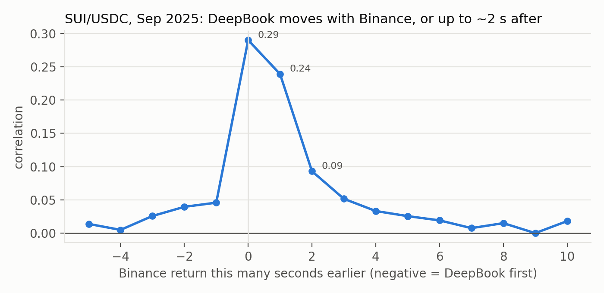

# deepbook-flowcast

**When does machine learning beat a simple rule at predicting short-term price moves on DeepBook, Sui's fully on-chain order book?**

DeepBook publishes every order placed, modified, cancelled and filled, with trader IDs, going back over a year. Most markets hide that. This project uses it to compare the classic **order book imbalance rule** against a ladder of models (logistic regression, gradient boosting) and to find *where* ML adds value: by horizon, pool liquidity, volatility, and market-maker behavior. It also tests how much of DeepBook's predictability is just lag behind Binance's SUI price. The main period is DeepBook's Aug–Oct 2025 peak; the quieter, bot-heavy 2026 market is the regime-shift test.

## Results

Each second, predict whether the DeepBook mid price is **up, flat or down** 1, 10 or 60 seconds later. Score: macro F1
(the mean F1 over the three classes, so always guessing "flat" scores poorly). The opponent is the **better** of two
classic rules, each tuned on the training data: the order book imbalance rule, and a Binance lead-lag rule (follow
Binance's SUI price when DeepBook's mid lags it). Intervals are 95%, from a bootstrap over days.

Train on Aug 2025, choose on Sep 2025 (single split + week-by-week walk-forward), then test **once** on data never
used before: Oct 2025, and Jul–Sep 2026 with the 2025 models frozen (a quieter, bot-heavy market).



**SUI/USDC (main pool): LightGBM beats the best rule at every horizon, in every test period.**

| Macro F1, model vs best rule | 1s | 10s | 60s |
|---|---|---|---|
| Sep 2025 (walk-forward, pooled) | 0.527 vs 0.361 | 0.463 vs 0.375 | 0.404 vs 0.366 |
| Oct 2025 (held out) | 0.520 vs 0.367 | 0.448 vs 0.341 | 0.397 vs 0.354 |
| Jul–Sep 2026 (held out) | 0.410 vs 0.351 | 0.470 vs 0.338 | 0.431 vs 0.345 |

Every gain's interval excludes zero. In walk-forward the model beat the rule in 23 of 24 pool-weeks.

**Accurate, but not tradable as a taker.** On every confidence level tested, in every period, crossing the spread
cost more than the average move the model predicted. The top 1% most confident SUI 1s calls were right on direction
86% of the time in October and still lost money after spread and fees.
Cost = the real bid-ask spread at that second (from the rebuilt book) + a taker fee of 1 bp per side, measured
from the fees recorded on each trade (paid in DEEP; makers pay 0). 2026 fees were ~2 bp per side, so 2026 costs are
understated; the conclusion only gets stronger.



**Binance leads, but the order book carries most of the signal.** DeepBook's SUI price moves with Binance in the same
second or up to ~2 s after (Sep 2025). Yet on SUI, adding Binance features to the model added only +0.005 to +0.014 macro
F1: a model on DeepBook's own data alone (0.40–0.47) already beats the Binance rule (0.36).



**The thin pool (DEEP/USDC) needs its own model, and is mixed.** The SUI-trained model scores 0.25–0.44 on DEEP vs
0.46–0.50 for a DEEP-trained one (Sep 2025). DEEP's own model beats the rule in Oct 2025 at every horizon (+0.06 to
+0.08) and in 2026 at 10s (+0.06), but **loses at 60s in 2026** (−0.014 [−0.026, −0.002]). Its 2026 1s gain (+0.36)
is mostly the rule failing in a market that often goes 30+ s without an order event, not model skill.

**How the model was chosen.** In walk-forward, retraining each week helped SUI 1s and hurt SUI 10s/60s, so the
October model was retrained on Aug–Sep for SUI 1s only. That choice was right for 1s (+0.05 in October; in 2026 the
Aug-only 1s model fell below the rule while the retrained one held). Elsewhere the retrained models were equal or
slightly better in October (by up to 0.010): the September pattern didn't carry over.

**Not tested:** maker (passive order) strategies, trading only when the spread is tight, latency, gas and price
impact. The CNN/LSTM rung of the original plan was cut.

Step-by-step history: [docs/LOG.md](docs/LOG.md). Notebooks `00`–`04`. Every number above comes from the CSVs under
`runs/`; `docs/make_figures.py` redraws the charts from them.

## Quickstart

```bash
uv sync --extra dev
cp .env.example .env                       # optional overrides

uv run flowcast pools                      # list DeepBook pools
uv run flowcast collect --start 2025-08-01 --end 2025-11-01   # DeepBook backfill (resumable)
uv run flowcast binance --start 2025-08-01 --end 2025-11-01   # Binance aggTrades, same days
uv run flowcast status                     # what's on disk
uv run flowcast snapshots --pools SUI_USDC # record live books (runs until Ctrl-C)
uv run pytest -q
```

## Layout

```
src/flowcast/
  collector/        raw data only; imports nothing from the ML side (tests/test_boundary.py)
    indexer_api.py  client for the public DeepBook indexer
    fetch.py        adaptive windows under the 10,000-row response cap
    store.py        hourly parquet in data/raw/ + manifest
    collect.py      resumable backfill, one unit = (stream, pool, hour)
    snapshots.py    live order book recorder -> data/snapshots/
    binance.py      Binance daily aggTrades -> data/raw/binance/ (lead-lag reference)
  book.py           rebuild the order book from raw events         (week 2)
  labels.py         up / flat / down, N seconds ahead               (week 2)
  features.py       imbalance, order flow, trades, vol, trader-aware (week 3)
  models/           the model ladder                                 (weeks 2-4)
  evaluate.py       walk-forward, bootstrap intervals, regime slices (weeks 3-4)
  cli.py            `flowcast` command
data/raw/           {orders,trades}/pool=X/date=Y/hour=HH.parquet
data/raw/binance/   {spot,um}/symbol=X/date=Y.parquet
data/snapshots/     pool=X/date=Y/part-*.parquet
```

## Data source

Public [DeepBookV3 indexer](https://docs.sui.io/standards/deepbookv3-indexer) by Mysten Labs (free, no key). If it ever goes away, it can be self-hosted from [MystenLabs/deepbookv3](https://github.com/MystenLabs/deepbookv3).

Binance reference trades come from [Binance public data](https://data.binance.vision) (free, no key): SUIUSDC and SUIUSDT spot, DEEPUSDT USD-M perp.

### Size (not in this repo: `data/` is gitignored; rebuild with the Quickstart commands)

Aug–Oct 2025 and Jul–Sep 2026, 184 days, both pools, every hour (0 truncated hours, 0 duplicates):

| | Rows | On disk |
|---|---|---|
| DeepBook order events (placed / modified / cancelled / expired) | 309M (SUI 286M, DEEP 23M) | 3.9 GB |
| DeepBook trades (fills) | 5.9M | 1.1 GB |
| Binance trades (SUIUSDC, SUIUSDT spot; DEEPUSDT perp) | 57.5M | 1.4 GB |
| Rebuilt order book, one row per second per pool | 31.8M | 1.4 GB |
| Features (37 per second) + labels | 31.8M | 3.9 GB |

~12 GB in total, Parquet.

## License

MIT
